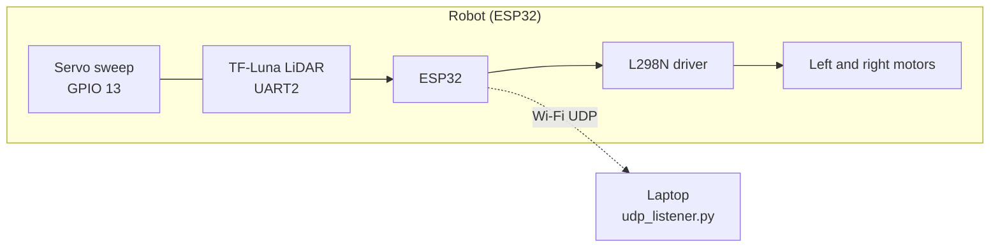
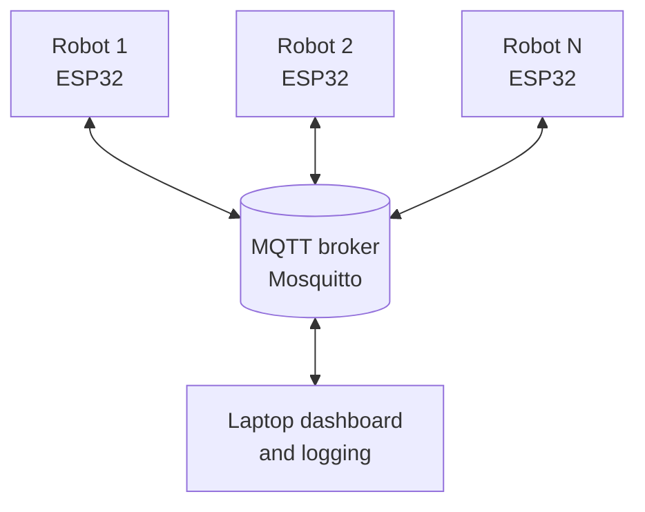
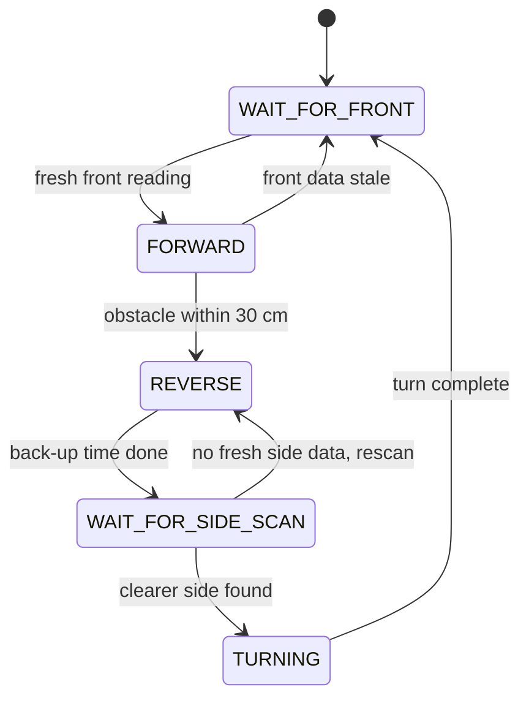

<div align="center">

# 🤖 ESP32-Based Swarm Robotics System

**A multi-robot platform built on ESP32, LiDAR and MQTT, developed as a final year engineering project.**


`ESP32` · `MQTT` · `LiDAR` · `Ultrasonic` · `Encoders`

</div>

<!-- Add a photo of the robot once you have one:

-->

---

## 🚧 Project status

> **This is an ongoing project.** About half of the work is complete. The single-robot platform
> (drive, LiDAR scanning, autonomous obstacle avoidance, wireless telemetry) works today. The swarm
> layer (MQTT, multi-robot coordination, encoders, ultrasonic) is being built next. This README is
> updated as each milestone lands.

```
Overall progress   ██████████░░░░░░░░░░  ~50%
```

| Area | Status |
|---|---|
| Motor control (L298N, differential drive) | ✅ Done |
| TF-Luna LiDAR UART driver | ✅ Done |
| Servo-mounted LiDAR sweep scanning | ✅ Done |
| Autonomous obstacle avoidance (state machine) | ✅ Done |
| Wi-Fi UDP telemetry + laptop listener | ✅ Done |
| Ultrasonic close-range sensing | 🔜 Planned |
| Wheel encoders and odometry | 🔜 Planned |
| MQTT messaging between robots | 🔜 Planned |
| Swarm coordination behaviours | 🔜 Planned |

---

## 🎯 Goal

Build a small fleet of low-cost ESP32 robots that can sense their surroundings, move
autonomously, and share information with each other over MQTT so that they can coordinate as a
swarm. Each robot combines a LiDAR for long-range mapping, an ultrasonic sensor for close range,
and wheel encoders for odometry.

## ✨ What works today (single robot)

- **Autonomous navigation:** drives forward and avoids obstacles without human input
- **LiDAR scanning:** a TF-Luna on a servo sweeps 20° to 160° and builds a left / front / right picture of the surroundings
- **Smart turning:** after backing away from an obstacle, the robot compares fresh left and right readings and turns toward the clearer side
- **Fail-safe behaviour:** stops and waits if front LiDAR data goes stale
- **Live telemetry:** every scan reading and action is streamed over Wi-Fi (UDP) to a laptop and logged to CSV
- **Bring-up test sketches:** separate tests for the motors, servo and LiDAR make hardware debugging easy

---

## 🧩 System architecture

### Current: single robot



### Target: swarm (planned)



Each planned robot adds an ultrasonic sensor and wheel encoders to the current sensor set.

---

## 🔌 Hardware

| Component | Role | Status |
|---|---|---|
| ESP32 development board | Controller, Wi-Fi | In use |
| L298N motor driver + DC motors | Differential drive | In use |
| TF-Luna LiDAR (UART) | Long-range distance | In use |
| Servo motor | Sweeps the LiDAR | In use |
| Ultrasonic sensor | Close-range sensing | Planned |
| Wheel encoders | Odometry | Planned |

### Pin map

| Function | ESP32 GPIO |
|---|---|
| Left motor: ENA / IN1 / IN2 | 25 / 26 / 14 |
| Right motor: ENB / IN3 / IN4 | 33 / 32 / 23 |
| Servo signal | 13 |
| TF-Luna: ESP32 RX / TX (UART2) | 16 / 17 |

The right motor direction is flipped in software with `REVERSE_RIGHT_MOTOR = true` to match the wiring.

---

## 🧠 How the obstacle avoidance works



1. The servo continuously sweeps the LiDAR from 20° to 160° in 5° steps.
2. Each valid reading is filed by angle: **below 75° is left, 75° to 105° is front, above 105° is right** (90° is assumed to face forward).
3. The robot drives forward while the front reading is fresh and above 30 cm.
4. On an obstacle it backs up briefly, stops, and waits for the sweep to refresh the side readings.
5. It then turns toward the clearer side and resumes.

A reading is accepted only if distance is between 1 and 800 cm and signal strength is above zero, and the frame checksum matches.

### Tunable settings (top of `obstacle_avoidance.ino`)

| Setting | Default | Meaning |
|---|---|---|
| `OBSTACLE_CM` | 30 | Distance that triggers avoidance |
| `MOTOR_SPEED` / `REVERSE_SPEED` / `TURN_SPEED` | 110 / 100 / 120 | PWM (0 to 255) |
| `REVERSE_TIME_MS` / `TURN_TIME_MS` | 450 / 450 | Duration of back-up and turn |
| `SCAN_WAIT_MS` | 2500 | Pause to collect side readings |
| `FRONT_STALE_MS` / `SIDE_STALE_MS` | 1800 / 6000 | Age after which a reading is ignored |
| `START_ANGLE` / `END_ANGLE` / `SERVO_STEP` | 20 / 160 / 5 | Sweep range and resolution |

---

## 📡 Telemetry

The robot sends text messages over UDP (robot port 4211 to laptop port 4210).

| Message | Format | Example |
|---|---|---|
| Scan reading | `SCAN,<robot_ms>,<angle_deg>,<distance_cm>,<strength>` | `SCAN,12840,90,142,3300` |
| Action event | `ACTION,<EVENT>` | `ACTION,OBSTACLE_REVERSE` |

Events: `WIFI_CONNECTED`, `FRONT_READING_READY`, `WAITING_FOR_FRONT_READING`, `OBSTACLE_REVERSE`,
`SCANNING_FOR_TURN`, `TURN_LEFT`, `TURN_RIGHT`, `TURN_COMPLETE`, `NO_FRESH_SIDE_DATA`, `REVERSE_AND_RESCAN`.

`tools/udp_listener.py` prints these messages live and saves scan readings to `scan_log.csv`
(handy for plotting the environment map later).

---

## 📁 Repository structure

```
.
├── README.md
├── LICENSE
├── .gitignore
├── firmware/
│   ├── obstacle_avoidance/          # main robot program
│   │   ├── obstacle_avoidance.ino
│   │   └── secrets.example.h        # copy to secrets.h
│   └── tests/                       # hardware bring-up sketches
│       ├── motor_movement_test/
│       ├── servo_sweep_test/
│       └── tf_luna_test/
└── tools/
    └── udp_listener.py              # laptop-side telemetry receiver
```

---

## 🚀 Getting started

### Requirements

- Arduino IDE 2.x (or VS Code with PlatformIO)
- ESP32 board package **3.x** (the code uses `analogWrite`)
- Library: **ESP32Servo** (Library Manager)
- Python 3 on the laptop (for the listener)

### 1. Test the hardware first

Run these small sketches one at a time, in this order, before the main program:

| Sketch | What it checks |
|---|---|
| `tests/motor_movement_test` | Both motor sides go forward, then backward (full PWM, so **lift the robot off the ground**) |
| `tests/servo_sweep_test` | Servo sweeps 0° to 180° smoothly |
| `tests/tf_luna_test` | TF-Luna prints distance and signal strength (prints a warning if no frames arrive) |

### 2. Flash the main program

1. Open `firmware/obstacle_avoidance/obstacle_avoidance.ino`.
2. Copy `secrets.example.h` to `secrets.h` and enter your Wi-Fi name, password and your laptop's IP address.
3. Select your ESP32 board and port, then upload.
4. The Serial Monitor (115200 baud) shows the same messages that are sent over Wi-Fi. If Wi-Fi is unavailable the robot keeps running locally.

### 3. Watch the telemetry

On the laptop (connected to the same network):

```
python tools/udp_listener.py
```

On Windows, allow Python through the firewall for UDP when prompted.

---

## 🗺️ Roadmap

**Phase 1: single robot platform** ✅
- [x] L298N differential drive with per-side direction correction
- [x] TF-Luna UART frame parser with checksum
- [x] Servo-mounted LiDAR sweep and left / front / right mapping
- [x] Obstacle-avoidance state machine
- [x] Wi-Fi UDP telemetry and CSV logging

**Phase 2: richer sensing** 🔜
- [ ] Ultrasonic sensor for close-range and blind-spot coverage
- [ ] Wheel encoders for speed and odometry
- [ ] Straight-line correction and accurate turns using encoder feedback

**Phase 3: swarm layer** 🔜
- [ ] MQTT client on every robot (Mosquitto broker)
- [ ] Robot-to-robot position and status sharing
- [ ] Collision avoidance between robots
- [ ] Coordinated behaviours (for example formation or area coverage)
- [ ] Dashboard for live monitoring

---

## 📝 Project log

| Date | Update |
|---|---|
| 2026-11-05 | Repository created. Single-robot obstacle avoidance with LiDAR sweep and UDP telemetry uploaded; test sketches added. |

---

## ⚠️ Notes

- Robots move on their own: test on a clear floor and keep a hand near the power switch.
- Wi-Fi credentials live only in `secrets.h`, which is excluded from git.

## 📄 License

MIT. See [LICENSE](LICENSE).
